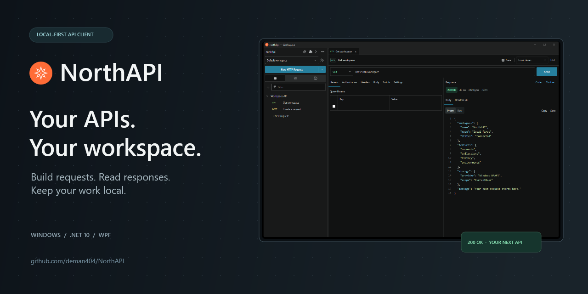
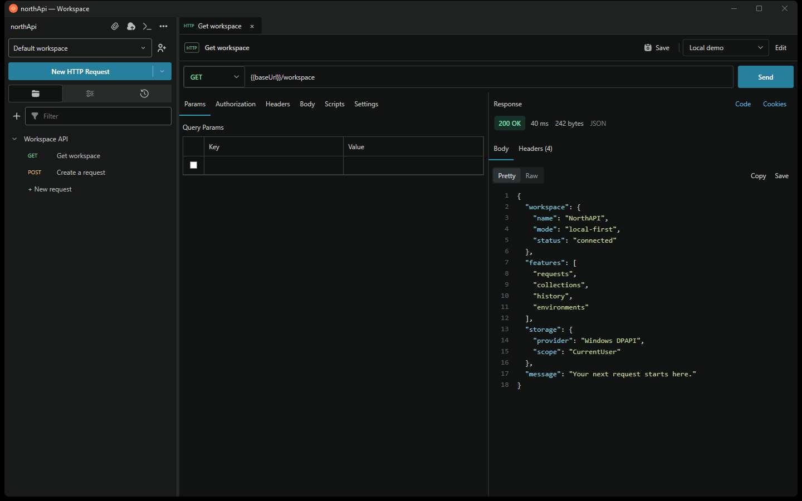
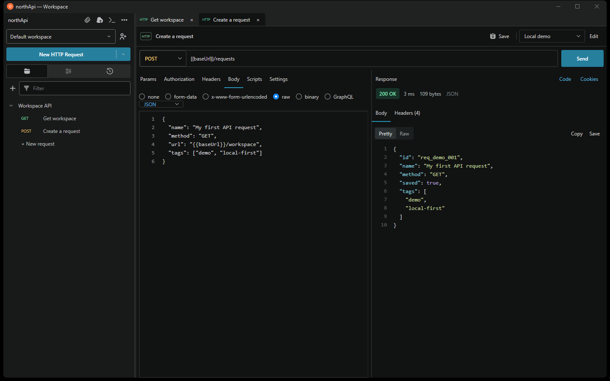
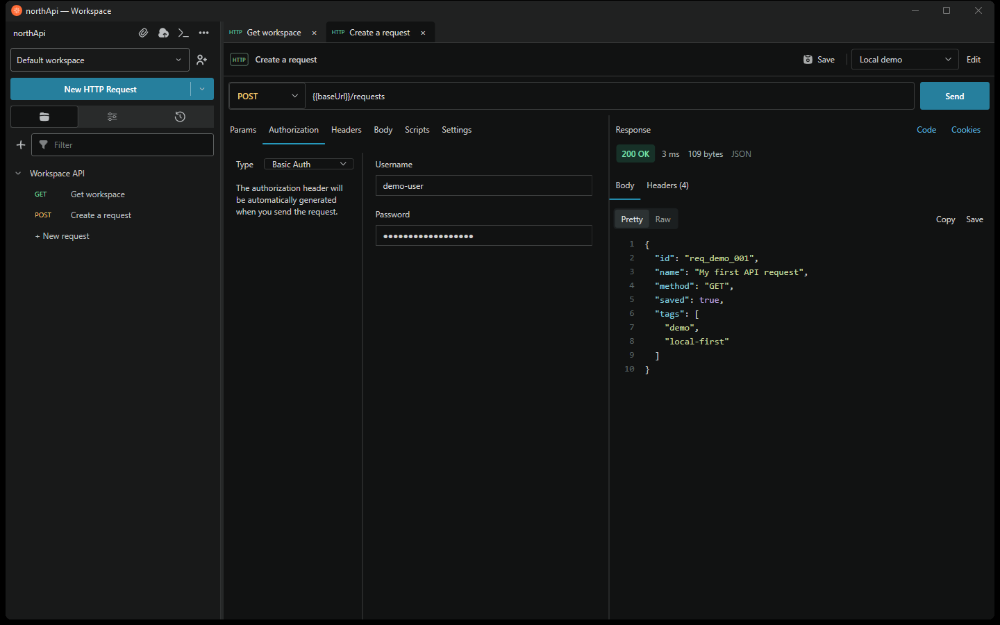

<p align="center">
  
</p>

<p align="center">
  <strong>A local-first REST API client for Windows.</strong><br />
  Compose requests, inspect responses, and keep your API workspace on your machine.
</p>

<p align="center">
  
  
  
  <a href="LICENSE"></a>
  <a href="RELEASE_QA.md"></a>
</p>

<p align="center">
  <a href="#screenshots">Screenshots</a> ·
  <a href="#getting-started">Get started</a> ·
  <a href="#your-first-request">First request</a> ·
  <a href="#testing--release-status">QA & release status</a>
</p>

---

NorthAPI brings the essentials of API development into a focused desktop workspace:
a method and URL, a configurable request, and a response you can actually read.
No product account or cloud workspace is required.

## What you can do

| Feature | Details |
| :--- | :--- |
| **Send real HTTP requests** | GET, POST, PUT, PATCH, DELETE, HEAD, and OPTIONS through `HttpClient`. |
| **Set parameters and headers** | Editable key/value tables with per-row enable/disable controls and URL-encoded query parameters. |
| **Control a running request** | Configurable timeout, cancellation, automatic redirects, and compressed-response decoding. |
| **Read responses clearly** | JSON formatting and colors, line numbers, Pretty/Raw views, status, elapsed time, size, and filterable headers. |
| **Build request bodies** | Raw JSON, text, JavaScript, HTML, XML, text form-data, URL-encoded forms, binary files, and GraphQL. |
| **Configure authentication** | Basic, Bearer, API Key, and manually supplied OAuth 2.0 access tokens. |
| **Organize your work** | Save requests to collections, reopen them, and import/export NorthAPI collection files. |
| **Pick up where you left off** | Local history of the latest 500 sent requests, including failures and cancellations. |
| **Switch environments** | Resolve `{{variables}}` in URLs, parameters, headers, auth, and request bodies. |
| **Take your request into code** | Generate C# `HttpClient` and cURL examples from the same request definition. |

## Screenshots

Real application captures using an isolated local demo server and synthetic data.

### A workspace built around the response



### Compose JSON and inspect the result



<details>
<summary><strong>See the authorization editor</strong></summary>



</details>

## Getting started

### Requirements

- Windows. The current QA run was performed on Windows 11.
- The **.NET 10 SDK** compatible with [`global.json`](global.json), currently pinned to SDK `10.0.403`.
- Git to clone the repository. Visual Studio is optional; WPF tooling is helpful when editing XAML.

### Build and run

Once the repository is published as `deman404/NorthAPI`:

```powershell
git clone https://github.com/deman404/NorthAPI.git
cd NorthAPI
dotnet restore NorthAPI.slnx
dotnet run --project northApi.csproj
```

Already have the source? Run the last two commands from the project folder.

### Create a self-contained x64 build

```powershell
dotnet publish northApi.csproj --configuration Release --runtime win-x64 --self-contained true --output artifacts/win-x64
```

Start `artifacts/win-x64/northApi.exe`. Keep the **entire output folder** together;
the build includes the .NET runtime and is not a single-file executable.

A self-contained build has been smoke-tested on the development PC. Verification
on a separate Windows PC without .NET is still pending.

## Your first request

1. Click **New HTTP Request**.
2. Choose **GET** and enter a URL, for example `https://httpbingo.org/get`.
3. Add any headers or authorization your API requires.
4. Click **Send**, or press **Ctrl+Enter** while the URL field is focused.
5. Inspect the status, duration, body size, and response headers. Use **Pretty** or
   **Raw**, then **Copy** or **Save** the response when needed.
6. Click the request's **Save** button to name it and choose a collection.

HTTP errors such as `400`, `401`, `429`, and `500` stay visible as responses.
Transport errors, timeouts, and canceled requests get a separate error state.

### Send a JSON body

Select **POST**, **PUT**, or **PATCH**, then open **Body → raw → JSON**:

```json
{
  "name": "NorthAPI",
  "message": "Hello from my local workspace"
}
```

The selected raw format supplies the content type. You can override headers in
the Headers tab. The same request definition is used for sending and generating code.

### Use environment variables

Create an environment from the sidebar, add enabled key/value pairs, and select
it in the request toolbar. For example:

| Variable | Example value |
| :--- | :--- |
| `baseUrl` | `https://httpbingo.org` |

Your URL can now be `{{baseUrl}}/post`. Values are resolved when sending or
generating code; the saved request keeps its placeholders. Missing variables and
cycles are rejected before a request is sent.

## More you can do

### Fine-tune a request

- **Params:** add query key/value pairs. Enabled rows are URL-encoded and appended
  to any query already in the URL; disabled rows are left out.
- **Headers:** add custom headers, enable or disable individual rows, and override
  the generated content type when your API needs something specific.
- **Settings:** choose a timeout from **1 to 600 seconds**; the default is 30 seconds.
  The timeout includes reading the response body.
- **Cancel:** while a request is running, **Send** becomes **Cancel**.
- **Tabs:** keep multiple request editors open and close them individually. Closing
  the last request returns to the empty workspace.
- **Transport:** redirects are followed automatically, and gzip, deflate, and Brotli
  responses are decoded. TLS certificate validation stays enabled.

### Pick the right body mode

| Body mode | What it sends |
| :--- | :--- |
| **none** | A request without a generated body. |
| **raw** | Text, JavaScript, JSON, HTML, or XML, with a matching content type and a line-numbered editor. |
| **form-data** | Enabled text key/value fields as multipart form-data. |
| **x-www-form-urlencoded** | Enabled form fields using URL encoding. |
| **binary** | The selected file as the request body. |
| **GraphQL** | A query and JSON variables object in a JSON request body. |

Switching body modes preserves the fields already entered in that editor.

### Choose authorization

| Option | Configuration |
| :--- | :--- |
| **No Auth** | No generated authorization; manually entered headers are still sent. |
| **Basic Auth** | Username and password; the password field is masked. |
| **Bearer Token** | A token sent using the `Authorization: Bearer` scheme. |
| **API Key** | A key name and value, added to a header or query parameters. |
| **OAuth 2.0** | An existing access token supplied manually. |

Environment variables can be used in the applicable auth fields as well as the URL.

### Work with collections and history

- Create a collection from the sidebar, or enter a new collection name while saving
  a request. Saving an existing request updates it; choosing a different collection
  moves it there.
- Expand a collection and select a saved request to reopen its settings. Use the
  sidebar filter to find collection/request names or request URLs.
- Use the sidebar's **Import collection** and **Export collections** toolbar actions
  for NorthAPI JSON files containing collections and their saved requests.
- Open **History** to review previous requests and their status or failure. Selecting
  an entry opens an independent request copy, so it does not overwrite a collection
  request. History timestamps are displayed in UTC.
- Create and edit environments from the sidebar or the request toolbar's **Edit**
  button. Disable a variable row to exclude it; references to other enabled variables
  are supported, with cycle detection.

### Inspect and reuse a response

- Switch between formatted **Pretty** and original **Raw** text.
- Read the HTTP status, request duration, decoded body size, and content type.
- Open **Headers** and filter by header name or value.
- **Copy** copies the currently displayed body; **Save** writes the original response
  text to a file. A truncated preview is explicitly marked, including what Copy/Save
  will contain.
- **Cookies** shows `Set-Cookie` values from the latest response. NorthAPI does not
  maintain an automatic browser-style cookie jar.
- **Code** opens the current request's C# / cURL generator. Select the language and
  copy the example with the selected environment values resolved.

## Local data & credentials

Workspace data is stored at:

```text
%LOCALAPPDATA%\NorthApi\workspace.json
```

The workspace payload and recovery backups use **Windows DPAPI**, bound to the
current Windows account. Collections, history, environment values, URLs, headers,
and auth settings are protected together. Request diagnostics use safe error
messages instead of echoing raw exception text.

Explicit collection exports and generated examples **retain the values you ask to
export**, including credentials when present. Treat those outputs as sensitive.
Use export/import to move collections between accounts or machines; a DPAPI-bound
workspace file is not a portable backup for another account.

For isolated testing, set `NORTHAPI_DATA_DIRECTORY` to a separate data folder.
The supplied QA tools use temporary folders and synthetic credentials.

## Testing & release status

**NorthAPI V1 is a preview.** The latest documented release QA run executed
**61 tests: 60 passed and 1 failed**. The existing regression harnesses separately
passed 62 HTTP/workspace checks and 16 WPF workflow checks.

The open failure is a Unicode request-body mismatch with the tested native
Windows cURL version. POSIX-shell validation and a separate clean-Windows deployment
check are also pending. These results are not presented as a production release pass.
See [`RELEASE_QA.md`](RELEASE_QA.md) for the actual evidence, reproduction steps,
fixes, and remaining blockers.

Run the discoverable QA suite:

```powershell
dotnet test NorthAPI.slnx --configuration Release --logger "trx;LogFileName=release-qa.trx" --results-directory artifacts/qa -p:IntermediateOutputPath=obj/qa10/
```

The known cURL regression currently makes the complete suite exit nonzero.
The suite includes external HTTPS tests that require network access. To run the
local deterministic cases without those external API calls, add:

```powershell
--filter "Category!=External"
```

The local subset still includes the known cURL regression. Fixture isolation,
individual checks, and published-build smoke testing are documented in
[`tests/ReleaseQA/README.md`](tests/ReleaseQA/README.md).

### Current boundaries

- OAuth 2.0 accepts an existing access token; acquiring or refreshing tokens is not implemented.
- AWS Signature, OAuth 1.0 signing, and request scripts are not implemented.
- Collection-level authorization inheritance is not configured; choose an explicit supported auth type when needed.
- Multipart form-data currently supports text fields; use binary mode to send a whole file.
- Large response previews are capped at 8 MiB and clearly marked when truncated.
- cURL output targets a POSIX shell. Do not assume a POSIX command can be pasted unchanged into PowerShell.

## Project layout

```text
components/       Reusable request, response, body, auth, and sidebar controls
pages/            Workspace window
models/           Request, collection, history, and environment definitions
services/         HTTP engine, request builder, persistence, variables, and code generation
assets/           WPF themes, icons, and illustration resources
tests/            Discoverable QA tests and workflow/regression tools
docs/images/      README screenshots and social-preview image
```

## Contributing

Bug reports and focused pull requests are welcome. Include a minimal reproduction,
the HTTP method, expected versus actual behavior, and a synthetic payload. Leave
real tokens, passwords, exported workspaces, and personal data out of issues,
screenshots, and test fixtures.

To refresh the README screenshots with local demo data:

```powershell
dotnet run --project tests/ReadmeCapture/ReadmeCapture.csproj --configuration Release -p:IntermediateOutputPath=obj/readme/ -- "$PWD/docs/images"
```

## License

Original project code is available under the [MIT License](LICENSE).
Third-party artwork retains its original rights; see [asset notices](THIRD_PARTY_NOTICES.md).

---

Built by **[deman404](https://github.com/deman404)** · [Contact](mailto:mr.aymanazhar.m@gmail.com)
